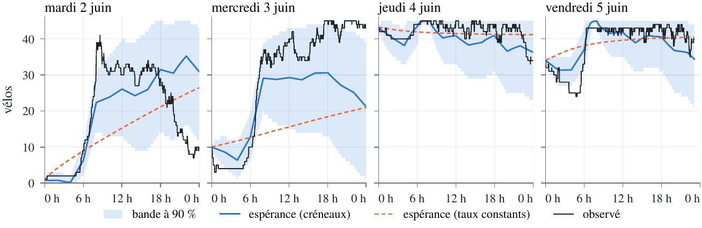
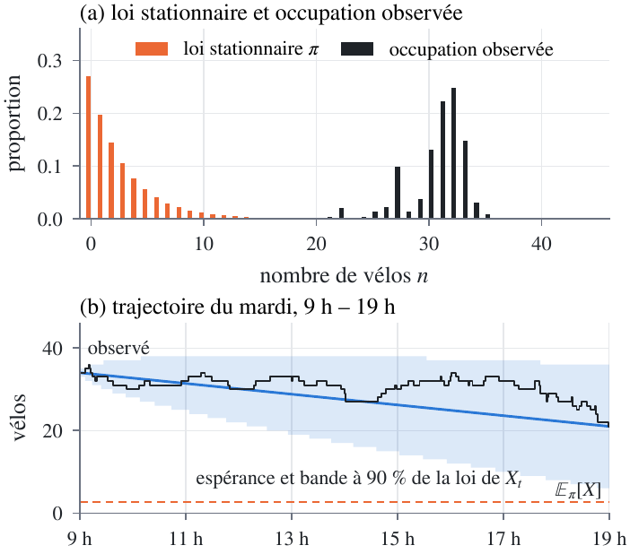
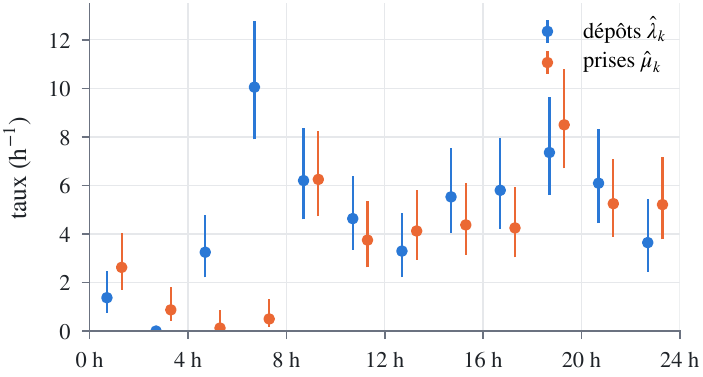

# Markov model of a Vélib' station

[](https://github.com/matthiasngn/velib-markov/actions/workflows/tests.yml)

A Paris bike-sharing station modelled as a continuous-time birth–death chain (an M/M/1/C queue), calibrated by maximum likelihood on minute-by-minute data and tested out of sample. The repository holds the paper and the code that produces every number, table and figure in it.

**Paper:** [`paper/article.pdf`](paper/article.pdf), 12 pages, in French with an English abstract.



*Gare de Lyon, 2–5 June 2026. Each day is forecast from the state observed at midnight, with rates estimated on the other three weekdays. Blue: expectation and 90% band with rates on two-hour slots. Dashed orange: constant rates. Black: observed.*

## Results

- Likelihood-ratio tests reject constant rates within a day ($p < 10^{-27}$).
- With rates constant on two-hour slots, out-of-sample 90% prediction bands cover 88% of the observed minutes at a two-hour horizon.
- The stationary law is never observed. Mixing times (5 to 48 hours) are longer than the time over which the rates stay constant, so what matters is the periodic regime of the inhomogeneous chain, which forgets its initial state by a factor 0.13 per day.
- Two numerical shortcuts in the preliminary study (counting only ±1 jumps, freezing the rates between jumps) had lowered its midday forecast by 16 bikes.

## Model

$X_t \in \lbrace 0, \dots, C \rbrace$ is the number of bikes at a station with $C$ docks. Bikes are returned at rate $\lambda$ while $X_t < C$ and taken at rate $\mu$ while $X_t > 0$. With $\rho = \lambda / \mu$, the stationary law is the truncated geometric distribution

$$\pi_n = \frac{\rho^n (1 - \rho)}{1 - \rho^{C+1}}, \qquad 0 \le n \le C,$$

and the spectrum of the generator is explicit. Its spectral gap is

$$\gamma = \left(\sqrt{\lambda} - \sqrt{\mu}\right)^2 + 4 \sqrt{\lambda \mu} \sin^2 \frac{\pi}{2(C+1)}.$$

From a path observed on $[0, T]$ with $N^\uparrow$ returns and $N^\downarrow$ pick-ups, the maximum-likelihood estimators are $\hat\lambda = N^\uparrow / T^\uparrow$ and $\hat\mu = N^\downarrow / T^\downarrow$, where $T^\uparrow$ and $T^\downarrow$ are the times during which a return, or a pick-up, was possible.

The paper covers:

1. **Probabilistic tools.** Existence, uniqueness and geometric convergence of the stationary law by a Doeblin contraction; the full spectrum of the generator, with lower and upper bounds on the distance to equilibrium; closed-form hitting times.
2. **Estimation.** Likelihood with exposure times, confidence intervals, likelihood-ratio tests, and what minute sampling hides.
3. **Simulation and exact computation.** Gillespie's algorithm with rates constant on slots, and the exact law of $X_t$ minute by minute from matrix exponentials.
4. **Data.** Why the stationary law fails, intraday seasonality, out-of-sample forecasts at 2 and 24 hours, the periodic regime, quality of service, and departures from the Poisson assumption (grouped arrivals, regulation trucks).
5. **Discussion.** The same framework in limit order books, credit-rating migration and backtesting.

<table>
  <tr>
    <td width="50%"></td>
    <td width="50%"></td>
  </tr>
  <tr>
    <td><em>Fitted on 9 am–7 pm, the stationary law puts the station near empty while it holds 30 bikes on average (a). The transient law started from the 9 am state contains the whole path (b).</em></td>
    <td><em>Return and pick-up rates by two-hour slot at Gare de Lyon, four weekdays pooled, with 95% confidence intervals.</em></td>
  </tr>
</table>

## Reproduce

Python 3.10 or later and a LaTeX distribution (the paper uses pdfLaTeX with the STIX2 font).

```bash
git clone https://github.com/matthiasngn/velib-markov.git
cd velib-markov
pip install -r requirements.txt

python code/calculs.py code data results         # every number cited -> results/resultats.json
python code/figures.py results paper/figures     # the seven figures
python code/remplir.py results/resultats.json paper/parts code/velib.py paper/article.tex
cd paper && pdflatex article.tex && pdflatex article.tex
```

`make all` runs the same steps. The simulations use fixed seeds, so a rerun gives the same numbers.

No number is typed into the paper by hand. The sources in `paper/parts/` hold placeholders such as `@@couv2h_en@@`, which `remplir.py` fills from `results/resultats.json`, and the listing in the appendix is `code/velib.py` itself.

`pytest` runs 35 checks of `velib.py` against closed-form results from the paper: stationary law, eigenvalues and eigenvectors of the generator, spectral gap, convergence bounds, Doeblin contraction, hitting times, exact transient law and estimators.

## Repository layout

```
code/
  velib.py            simulation, estimation and exact computation (Appendix A of the paper)
  parse_releves.py    raw minute tables -> data/*.csv
  donnees.py          loads the CSV files on a one-minute grid
  calculs.py          all computations -> results/resultats.json and results/series.npz
  figures.py          figures from those outputs
  remplir.py          fills the numbers and the code into paper/parts/ -> paper/article.tex
data/                 cleaned readings, one row per minute (see data/README.md)
paper/
  article.tex, article.pdf
  parts/              LaTeX sources with @@key@@ placeholders
  figures/            the seven figures (PDF)
results/              resultats.json: every number cited in the paper
tests/                checks of velib.py against the theory
docs/img/             PNG copies of the figures for this page
```

The code and its comments are in French, like the paper.

## Data

Minute-by-minute readings of four Paris stations from the Vélib' Métropole real-time open data, collected through [velib.nocle.fr](https://velib.nocle.fr):

| Station | Docks | Period |
|---|---|---|
| Gare de Lyon | 45 | weekdays 1–5 June 2026, weekend 23–24 May |
| Nation | 36 | weekdays 1–3 June 2026, weekend 23–24 May |
| Parc des Princes | 32 | weekend 23–24 May 2026 |
| Claude Terrasse | 46 | weekend 23–24 May 2026 |

Formats, coverage and cleaning steps are in [`data/README.md`](data/README.md).

## Background

This work started as my TIPE, the research project of the French *classes préparatoires*, defended at the Mines-Ponts oral exams in June 2026 (MP*, Lycée Sainte-Geneviève). The paper, written in November 2026, extends it and corrects two numerical biases of that first version (Section 5.2).

## License

Code under the [MIT License](LICENSE). Paper text and figures under [CC BY 4.0](https://creativecommons.org/licenses/by/4.0/). The readings come from Vélib' Métropole open data.
